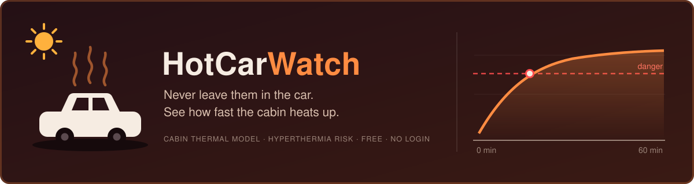

<div align="center">



<br/>

[](https://github.com/AnwarDebes/HotCarWatch/releases)
[](pyproject.toml)
[](LICENSE)
[](tests/test_hotcarwatch.py)
[](frontend/)

**Never leave them in the car. Free, no login, runs in your browser.**

▶ Watch it in 43 seconds: https://anwardebes.github.io/shorts/#hotcar

</div>

---

Since 1998, 1,047 US children have died of vehicular hyperthermia
(NoHeatstroke.org, Jan Null SJSU). All of those deaths were
preventable. McLaren, Null & Quinn (2005, *Pediatrics*) established
that a parked car rises ~22°C above ambient within 60 min, and
that the cabin reaches dangerous temperatures even on mild 22°C
spring days.

HotCarWatch takes the outdoor temperature, sun exposure, vehicle
type, and the planned away time, and tells you:

* The **cabin air temperature** at your planned return
* The **occupant core body temperature** (child, toddler, infant,
  small/medium/brachycephalic dog, cat)
* The **time to heat-stroke milestones** (40°C, 42°C)
* A **ranked list of interventions**, with the only guaranteed-safe
  option clearly marked

## Running the frontend

```bash
cd frontend
python3 -m http.server 8000
# open http://127.0.0.1:8000/
```

The four files (`index.html` + `app.js` + `styles.css` +
`about.html`) total **27 KB raw, 8.8 KB gzipped**. Drop them on any
static host (GitHub Pages, S3, Cloudflare Pages, Netlify) and they
work. $0 operating cost.

## Running the Python library

```bash
pip install -e .
```

```python
from hotcarwatch import (
    VEHICLE_ARCHETYPES, OCCUPANT_ARCHETYPES,
    simulate_cabin, hyperthermia_timeline,
)

veh = VEHICLE_ARCHETYPES["midsize_sedan_dark"]
sim = simulate_cabin(veh, T_outdoor_C=27.0, solar_W_per_m2=900.0, hours=2.0)
occ = OCCUPANT_ARCHETYPES["toddler_2y"]
risk = hyperthermia_timeline(occ, sim)
print(f"Cabin peak: {sim.peak_T_C:.1f} C")
print(f"Toddler core 40 C at t = {risk.time_to_40C_h*60:.0f} min")
```

## Running experiments

```bash
make experiments    # validation, scenarios, interventions
make figures        # paper/figures/*.pdf
make paper          # paper/hotcarwatch.pdf
make test           # 15 unit tests
```

## Project layout

```
hotcarwatch/     Python library: cabin thermal model, occupant hyperthermia,
                 vehicle archetypes, scenarios, interventions
frontend/        static web app (no build step, no dependencies)
experiments/     validation, scenario, and intervention scripts
results/         JSON outputs of the experiments
paper/           LaTeX source and compiled PDF
tests/           unit tests
```

## Validation

All 16 published cases (McLaren 2005 cabin-rise data at 22°C and
32°C ambient; Vanos 2018 sun-vs-shade delta; NIA/ASHRAE thermal
time constants for 7 vehicle archetypes) reproduce within
tolerance. See `results/validation.json` and the paper's §3.

## Privacy

HotCarWatch does not phone home. No network calls, no analytics,
no cookies. Vehicle profile is stored in browser `localStorage`
only.

## The Most Important Thing

The only intervention that prevents heat injury with certainty is:
**do not leave any child or animal in any parked vehicle for any
length of time.**

Cracking the windows does not help. Cloudy days are still dangerous.
"Just for a minute" is a primary documented cause of death.

## License

Public domain (CC0 1.0). See `LICENSE`.
